# 🛡️ CyberSER: Real-Time Speech Emotion Analysis for Cybercrime Investigation

## 📋 Problem Statement
- **Domain:** Cybersecurity
- **Challenge:** Real-Time Speech Emotion Analysis (SER) for Cybercrime Investigation
- **Help:** Cybercrime police officers analyze live/recorded phone calls to detect vocal patterns of Fear, Anger, Distress, Nervousness
- **Calculate:** Real-time Call Urgency Score for triage

## 🎯 Solution Overview
- **Tactical Audio Triage Command Center**
- **Real-time DSP-based acoustic analysis**
- **Multi-call priority queue with automatic urgency scoring**
- **Privacy-preserving design with PII redaction**
- **Responsible AI guardrails**

## 🏗️ System Architecture

Include a Mermaid.js diagram:

```mermaid
graph TB
    subgraph Input Layer
        A[📞 Live Call / 1930 Helpline] --> B[Audio Capture Module]
        C[📁 Uploaded WAV Files] --> B
        D[🎙️ Microphone Input] --> B
    end
    
    subgraph DSP Processing Engine
        B --> E[Pre-processing<br/>Resampling, Normalization]
        E --> F[Frame Segmentation<br/>500ms windows, 250ms hop]
        F --> G[Acoustic Feature Extraction]
        G --> G1[F0 / Pitch Analysis]
        G --> G2[Jitter & Shimmer]
        G --> G3[RMS Energy & ZCR]
        G --> G4[13-Band MFCC]
        G --> G5[Spectral Analysis]
        G --> G6[Speech Rate / Tempo]
    end
    
    subgraph Emotion Scoring Engine
        G1 & G2 & G3 & G4 & G5 & G6 --> H[Multi-Factor Emotion Classifier]
        H --> I[Emotion Probabilities]
        I --> I1[😰 Distress]
        I --> I2[😨 Fear]
        I --> I3[😠 Anger]
        I --> I4[😬 Nervousness]
        I --> I5[😌 Calm]
    end
    
    subgraph Urgency Assessment
        I1 & I2 & I3 & I4 & I5 --> J[Urgency Score Calculator]
        K[🔑 Keyword Detection] --> J
        J --> L[Composite Urgency Index 0-100]
        L --> M{Priority Classification}
        M -->|80-100| N[🔴 CRITICAL - GOLDEN HOUR]
        M -->|60-79| O[🟠 HIGH URGENCY]
        M -->|40-59| P[🟡 MODERATE]
        M -->|0-39| Q[🟢 LOW]
    end
    
    subgraph Command Center UI
        N & O & P & Q --> R[Multi-Call Triage Queue]
        R --> S[Live Visual Telemetry]
        S --> S1[Waveform & Spectrogram]
        S --> S2[Emotion Timeline]
        S --> S3[Radar Chart]
        S --> S4[Urgency Gauge]
        R --> T[Officer Action SOP]
    end
    
    subgraph Privacy & Security Layer
        U[🔒 PII Redaction Engine] --> R
        V[🔐 SHA-256 Audio Integrity] --> R
        W[⚖️ Responsible AI Module] --> R
        X[🗑️ Ephemeral Memory Processing] --> R
    end
```


## 🔬 Acoustic Science & DSP Formulation

### Fundamental Frequency (F0)
Pitch detection using autocorrelation / pYIN algorithm. The formula:
$$F_0 = \frac{1}{T_0}$$
where $T_0$ is the fundamental period.

### Jitter (Pitch Perturbation)
$$Jitter(\%) = \frac{\frac{1}{N-1}\sum_{i=1}^{N-1}|T_i - T_{i+1}|}{\frac{1}{N}\sum_{i=1}^{N}T_i} \times 100$$

### Shimmer (Amplitude Perturbation)
$$Shimmer(\%) = \frac{\frac{1}{N-1}\sum_{i=1}^{N-1}|A_i - A_{i+1}|}{\frac{1}{N}\sum_{i=1}^{N}A_i} \times 100$$

### MFCC (Mel-Frequency Cepstral Coefficients)
Pipeline: Pre-emphasis → Framing → Windowing → FFT → Mel Filter Bank → Log → DCT

### Emotion-Acoustic Mapping Table
| Emotion | F0 (Hz) | Jitter (%) | Shimmer (%) | RMS Energy | Speech Rate | Spectral Centroid |
|---------|---------|------------|-------------|------------|-------------|-------------------|
| Distress | >220 ↑↑ | >4% ↑↑ | >6% ↑↑ | Variable ↕ | Erratic | Moderate |
| Fear | >200 ↑ | >3.5% ↑ | >4% ↑ | Low-Moderate | Fast ↑ | Moderate-High |
| Anger | Variable | Low-Moderate | Low | Very High ↑↑ | Fast ↑ | Very High ↑↑ |
| Nervousness | Moderate-High | 2.5-5% ↑ | 3-5% | Moderate | Irregular ↕ | Moderate |
| Calm | 100-180 | <2% | <3% | Low-Moderate | Steady | Low-Moderate |

## ⚖️ Responsible AI & Privacy Framework

### Ethical AI Principles
1. **Non-Deterministic Advisory**: Emotions are probabilistic indicators, not evidence
2. **Human-in-the-Loop**: All assessments require officer verification
3. **Bias Awareness**: System trained on synthetic data; real deployment requires diverse voice datasets
4. **Transparency**: Full XAI reasoning for every prediction
5. **Privacy by Design**: PII redaction, ephemeral processing, no persistent storage

### Privacy Controls
- PII Redaction Engine (phone, Aadhaar, PAN, bank accounts, names, emails)
- In-Memory Ephemeral Processing (no audio persisted after session)
- SHA-256 Audio Integrity Hashing for chain-of-custody
- Compliant with IT Act 2000, DPDP Act 2023 principles

### Limitations & Disclaimers
- Acoustic analysis alone cannot determine deception or guilt
- Cultural and linguistic variations affect vocal expressions
- Synthetic training data may not represent real-world diversity
- System is a decision-support tool, not a decision-making tool

## 🚀 Setup & Installation

```bash
# Clone the repository
git clone <repo-url>
cd vegnaverse

# Create virtual environment (recommended)
python -m venv venv
source venv/bin/activate  # Linux/Mac
venv\Scripts\activate     # Windows

# Install dependencies
pip install -r requirements.txt

# Generate demo audio files
python generate_demo_calls.py

# Launch the React command center
pnpm install
pnpm run dev

# Optional legacy Streamlit interface
streamlit run app.py
```

### Command center interactions

- **Navigation** — every command-center destination (Overview, Triage Queue, Live Monitor, Intelligence, Case Files) is reachable from both the sidebar and the header quick-nav tabs; the active view, heading, and tab stay in sync.
- **Audio playback** — the evidence transport plays the bundled 16 kHz WAV demos through a Web Audio analyser. If a browser cannot decode a source, a deterministic synthetic voice sample is generated locally so the demo remains playable.
- **Live visuals** — waveform, emotion radar, emotion timeline, MFCC column, and transcript playhead all follow the audio playhead (or the microphone stream while capturing).
- **Live clock** — the header shows a live IST clock (HH:MM:SS plus date) refreshed every second from the system clock.
- **Microphone capture** — `Mic capture` records locally, streams a live transcript when the browser exposes speech recognition, and feeds the same waveform/radar pipeline.

### Verification

```bash
pnpm run test:smoke   # 44 DOM/interaction assertions (jsdom + Vite SSR build)
```

### Deploy to Render

The repository ships a Render Blueprint ([render.yaml](render.yaml)) that provisions a **free static site**:

- Build command: `npm ci && npm run build`
- Publish directory: `./dist`
- Node pinned to 22.12.0 via [.node-version](.node-version)
- SPA rewrite `/* → /index.html` and long-lived caching for `/assets/*`

**One-click:** open <https://render.com/deploy?repo=https://github.com/opzain/Codex_SyedZainuddin> and approve the Blueprint.

**Manual:** Render Dashboard → **New → Blueprint** → connect `opzain/Codex_SyedZainuddin` → **Apply**. This installs the GitHub App webhook, so every push to `main` redeploys automatically.

**API:** set `RENDER_API_KEY` (Render → Account Settings → API Keys), then run `./scripts/deploy-render.ps1 -ApiKey rnd_...`. The script creates a `static_site`, forces the publish path to `./dist` (the REST field is `publishPath`, not the Blueprint's `staticPublishPath`), waits for the deploy to go live, and prints the URL. A service created this way has no GitHub webhook: trigger builds with `POST /v1/services/{id}/deploys` or click **Manual Deploy** in the dashboard. Connect the repo under **Settings → Build & Deploy** to enable push-to-deploy.

Live instance: <https://cyberser-command-center.onrender.com>


## 📁 Project Structure
```
vegnaverse/
├── src/main.jsx                    # React command center UI
├── src/styles.css                  # SOC visual system
├── public/sample_calls/            # Browser-accessible demo audio
├── package.json                    # React/Vite scripts
├── app.py                          # Optional legacy Streamlit UI
├── audio_engine.py                 # DSP analysis engine
├── generate_demo_calls.py          # Demo audio synthesizer
├── requirements.txt                # Python dependencies
├── README.md                       # Documentation
└── sample_calls/                   # Generated demo audio
    ├── call_101_victim_upi_fraud.wav
    ├── call_102_informant_ransomware_tip.wav
    ├── call_103_angry_account_compromise.wav
    ├── call_104_suspected_vishing_caller.wav
    └── call_metadata.json
```

## 🔄 Comparison with Existing Platforms

| Feature | CyberSER (Ours) | Commercial SER APIs | Academic SER Models |
|---------|-----------------|--------------------|--------------------|
| Real-time Analysis | ✅ Sliding window | ❌ Batch only | ⚠️ Varies |
| Cybercrime-Specific | ✅ Keyword fusion | ❌ Generic | ❌ Generic |
| Privacy-Preserving | ✅ Ephemeral + PII | ⚠️ Cloud upload | ❌ No privacy focus |
| Explainable AI | ✅ Full XAI reasoning | ❌ Black box | ⚠️ Limited |
| Offline Capable | ✅ No internet needed | ❌ API dependent | ⚠️ Large models |
| Multi-Call Triage | ✅ Priority queue | ❌ Single analysis | ❌ Single analysis |
| Indian Context | ✅ 1930 Helpline, PAN/Aadhaar | ❌ Western-centric | ❌ Western-centric |
| Cost | ✅ Free/Open Source | ❌ Per-API-call cost | ✅ Free |

## 🛠️ Technology Stack
- **Frontend:** React 19 + Vite + SVG telemetry + custom responsive CSS
- **Legacy UI:** Streamlit + Plotly remains available via `app.py`
- **Audio DSP:** Librosa + SciPy Signal Processing
- **ML Pipeline:** Heuristic scoring engine + wav2vec2 hook
- **Data Processing:** NumPy + Pandas
- **Security:** SHA-256 hashing, regex PII redaction
- **Visualization:** Plotly (Radar, Gauge, Timeline, Spectrogram)

## 📊 Key Innovation Points
1. **Acoustic-Semantic Fusion:** Combines voice stress analysis with cybercrime keyword detection
2. **Golden Hour Integration:** Automatic prioritization for financial fraud cases requiring immediate bank action
3. **Indian Cybercrime Context:** Tailored for 1930 helpline workflows, Indian PII formats, and local crime patterns
4. **Zero-Infrastructure:** Runs entirely locally without cloud dependencies

## 👥 Team
- Hackathon Entry by Team Vegnaverse

## 📜 License
MIT License - Open Source for Public Safety Innovation

---
*Built with ❤️ for safer digital India*